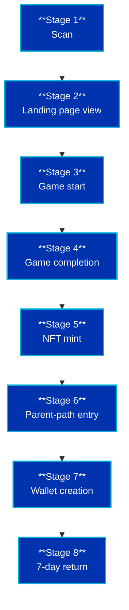

# Metrics & Funnel Definitions

> **Principle:** track the funnel, not vanity metrics.
> Scan count and follower count are diagnostic only — never the goal.

---

## 1. 📊 The Funnel

| # | Stage | Metric | Pilot Target |
|---|---|---|---|
| 1 | Scan | Scan count | baseline |
| 2 | Landing page view | Landing view rate | ≥ 70% |
| 3 | Game start | Game start rate | ≥ 50% |
| 4 | Game completion | Completion rate | ≥ 30% |
| 5 | NFT mint | Mint rate | ≥ 15% |
| 6 | Parent-path entry | Parent entry rate | ≥ 20% |
| 7 | Wallet creation | Wallet rate | ≥ 10% |
| 8 | 7-day return | Retention | ≥ 15% |
---

## 2. Metric Definitions

| # | Metric | Definition | Formula |
|---|---|---|---|
| 1 | **Scan count** | QR scans recorded by the redirect service | raw count |
| 2 | **Landing view rate** | % of scans that load the landing page | `landing_views / scans` |
| 3 | **Game start rate** | % of landing views that start the game | `game_starts / landing_views` |
| 4 | **Game completion rate** | % of game starts that finish | `completions / game_starts` |
| 5 | **NFT mint rate** | % of completions that mint an NFT | `mints / completions` |
| 6 | **Parent-path entry rate** | % of child users whose parent opens the explainer | `parent_entries / completions` |
| 7 | **Wallet creation rate** | % of parent entrants who create a wallet | `wallets / parent_entries` |
| 8 | **7-day retention** | % of wallet creators active again within 7 days | `returning / wallets` |
| 9 | **Revenue per completed loop** | Revenue ÷ completed loops | `revenue / completions` |
| 10 | **Cost per wallet** | Pilot spend ÷ wallets created | `spend / wallets` |

---

## 3. Pilot Targets

| Metric | Target | Stretch |
|---|---|---|
| Game completion rate | ≥ 30% | ≥ 45% |
| NFT mint rate | ≥ 15% | ≥ 25% |
| Parent-path entry rate | ≥ 20% | ≥ 30% |
| Wallet creation rate | ≥ 10% | ≥ 20% |
| 7-day retention | ≥ 15% | ≥ 25% |

> If any core metric falls below **half** its target after 2 weeks, pause and iterate
> before scaling spend.

---

## 4. Tracking Spreadsheet Template

Copy this table into a spreadsheet. One row per week.

| Week | Scans | Landing views | Game starts | Completions | Mints | Parent entries | Wallets | 7-day returns | Revenue (R) | Spend (R) |
|---|---|---|---|---|---|---|---|---|---|---|
| W1 | | | | | | | | | | |
| W2 | | | | | | | | | | |
| W3 | | | | | | | | | | |
| W4 | | | | | | | | | | |

**Derived columns (formulas):**

---

## 5. Instrumentation Checklist

- [ ] QR redirect service with UTM parameters per placement (T-shirt, poster, event)
- [ ] Landing page analytics (page view, game start event)
- [ ] Game completion event fired to analytics
- [ ] Mint confirmation event fired (testnet + mainnet)
- [ ] Parent-path entry event fired
- [ ] Wallet creation event fired (no personal data captured)
- [ ] 7-day return tracked via anonymised session ID, not personal data

---

## 6. Placement Attribution

Every QR code gets a **unique UTM tag** so we can compare channels:

| Placement | UTM source | UTM medium | UTM campaign |
|---|---|---|---|
| T-shirt | `tshirt` | `qr` | `pilot-w1` |
| Wall poster | `poster` | `qr` | `pilot-w1` |
| Table card | `tablecard` | `qr` | `pilot-w1` |
| Event booth | `event` | `qr` | `pilot-w1` |
| Car magnet | `carmagnet` | `qr` | `pilot-w1` |

This lets us answer: **which physical placement produces the best wallet-creation rate per rand spent?**

---

## 7. Reporting Cadence

| Cadence | Audience | Format |
|---|---|---|
| Weekly | Team | Spreadsheet update |
| Bi-weekly | Partners | 1-page summary |
| Post-pilot | Investors / ecosystem | Full report in `pilot/results.md` |

---

## 8. What We Will NOT Report As Success

- ❌ Raw scan count
- ❌ Follower count
- ❌ Impressions
- ❌ "Vibes"

These are inputs at best. The funnel is the story.
