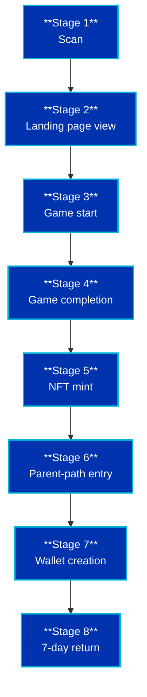

# Overview & Strategic Rationale

> **The full story behind the Cardano Family QR Experience** — what it is, why it exists, who it serves, and how it makes money.

**Related:** [README](README.md) · [Compliance](compliance.md) · [Messaging](messaging.md) · [Metrics](metrics.md) · [Pilot plan](../pilot/plan.md)

---

## 1. In One Sentence

> A physical-to-digital growth engine that turns QR-code curiosity into engaged Cardano users — through a children's mini-game and a parent education path.

---

## 2. The Full Picture

The Cardano Family QR Experience places QR codes on T-shirts, posters, table cards, and event booths. When someone scans, they land on a simple two-door page:

- **Children (6–14)** play a short web-based mini-game and mint their **first free NFT on Cardano** — a real digital asset they own, with no download and no wallet required to start.
- **Parents** get a 90-second plain-language explainer of what just happened, and an **optional** next step: create a beginner-friendly wallet and receive a small amount of ADA to *use* — not to hold.

One scan serves two audiences at once. The child creates the emotional hook; the parent becomes the qualified, engaged user.

The entire experience is **compliant by design** — built around South Africa's FSCA and ARB advertising rules, with no return promises and no investment advice.

---

## 3. Why We Are Building This

### 3.1 Cardano is perceived as hard to enter
The ecosystem has over-invested in infrastructure and under-invested in user experience and public narrative. Families are curious but bounce off jargon and price charts.

### 3.2 Most crypto marketing talks *at* people
It targets speculators, not households. There is no safe, fun, family-friendly on-ramp.

### 3.3 Digital-only growth is easy to ignore
A physical QR code on a T-shirt creates curiosity in the real world — a hook no ad impression can replicate.

### 3.4 Children pull parents in — not the other way around
A child creating something real and free is a far stronger conversion moment than pitching ADA to a skeptical adult.

---

## 4. The Core Insight

> **Children pull parents in — not the other way around.**

- Kids engage with **play and creation**.
- Parents engage with **understanding and safety**.
- A **family experience converts better than a solo pitch**.

Instead of selling ADA to a skeptical adult, we let a child create something real and free. The parent's natural question — *"what just happened?"* — becomes our conversion moment.

---

## 5. The Core Loop

**Stage-by-stage:**

| Stage | What happens | Who is served |
|---|---|---|
| 1. Scan | QR code on physical object | — |
| 2. Landing view | Two-door selection page | Both |
| 3. Game start | Child begins mini-game | Child |
| 4. Completion | Child finishes game | Child |
| 5. NFT mint | Child mints free collectible | Child |
| 6. Parent entry | Parent opens explainer | Parent |
| 7. Wallet creation | Parent creates optional wallet | Parent |
| 8. 7-day return | User comes back | Both |

**Full metric definitions:** [Metrics](metrics.md)

---

## 6. The Child Experience

- Web-based H5 mini-game — **no download required**
- Objective: collect fragments → synthesize an NFT
- **Real mint on Cardano** using no-code tooling (e.g. NMKR Studio)
- NFT = **proof of participation**, explicitly not a speculative asset
- Outcome: the child owns a genuine digital asset — the most intuitive way to teach "what is blockchain"

**Design principles:**
- Finishable in **under 3 minutes**
- No reading required beyond simple prompts
- No personal data collected
- No in-game purchases without parent confirmation

---

## 7. The Parent Experience

- **"What just happened?"** plain-language explainer (90 seconds, no jargon)
- Optional next step: create a beginner-friendly wallet, receive **2–5 ADA**
- **Use it once** — mint another NFT for the child, or vote on a community proposal
- **Education first; investment is never promised**

**Design principle:**
> *"Using it once" beats "buying and holding" for real engagement — and creates a repeat-use habit that drives revenue.*

---

## 8. Physical Placement Strategy

| Channel | Priority | Rationale |
|---|---|---|
| T-shirts / hats | ✅ High | Zero legal risk; natural conversation starter |
| Wall posters / table cards | ✅ High | Static scene; ample scan time |
| Event booths | ✅ High | Captive, curious audience |
| Small car magnets (private car) | ⚠️ Low | Confirm insurance/lease terms; avoid driver distraction |
| LED / light-box / large vehicle wraps | ❌ Avoid | South African enforcement risk; road-safety hazard |

**Note on vehicle advertising:** South African outdoor advertising guidelines (SAMOAC) discourage vehicles used solely for advertising and complex moving displays. Cape Town recently required Bolt to remove rooftop LED advertising screens, citing the National Road Traffic Act and road-safety concerns. **We therefore treat vehicles as light, passive exposure only — never the primary channel.**

---

## 9. Revenue Model

The loop is designed so that **engagement converts into multiple revenue streams**, without ever promising investment returns.

| Stream | Mechanism | Notes |
|---|---|---|
| **NFT minting fees** | Small fee per child NFT mint beyond the free first mint; premium collectible packs | Core repeatable revenue |
| **Premium game content** | Additional mini-games / seasonal drops / unlockable characters | Subscription or one-off |
| **Parent onboarding services** | Guided wallet setup, family account features, educational courses | Paid tier |
| **Brand partnerships** | Co-branded QR campaigns with family-friendly local businesses | Sponsorship revenue |
| **Ecosystem grants & bounties** | Catalyst / ecosystem funding for onboarding and content | Non-dilutive funding |
| **Affiliate / referral** | Referral rewards for wallet providers or tooling partners (compliant disclosure) | Secondary |

**Key principle:** revenue comes from **creation, content, and services** — not from promising returns on ADA. This keeps the model sustainable and compliant.

---

## 10. Compliance & Trust (Non-Negotiable)

- **South Africa:** crypto assets are financial products under FAIS, regulated by the **FSCA**. Google Ads policy also requires FSCA registration for crypto exchange/wallet advertising targeting South Africa.
- **ARB Code of Advertising Practice:** crypto ads must state that investment may result in loss of principal; must not exploit inexperience; must not promise returns.
- **Language rule:** say *learn, create, experience, own* — **never** *earn, returns, easy, fast*.
- **All materials carry a risk warning** where financial products are referenced.
- **Any future discussion of ADA's investment attributes** requires confirming licensing obligations first.

> Safer language is not just legally required — it also attracts **better, longer-term users** and protects the brand.

**Full checklist:** [Compliance](compliance.md) · **Approved copy:** [Messaging](messaging.md)

---

## 11. Who This Serves

| Audience | What they get | What we get |
|---|---|---|
| **Children (6–14)** | A free mini-game and their first NFT | Emotional hook, word-of-mouth |
| **Parents** | A plain-language explainer and an optional first wallet | Qualified, engaged users |
| **Our team** | A single source of truth for strategy, copy, and compliance | Alignment |
| **Partners & pilot venues** | A clear, honest picture of what we are building | Trust |
| **Ecosystem & grant reviewers** | An open, auditable plan with defined metrics | Credibility |
| **Other builders** | A reusable, compliance-first template | Goodwill, inbound |

---

## 12. What Success Looks Like

A measurable funnel — **Scan → Landing view → Game start → Completion → NFT mint → Parent entry → Wallet creation → 7-day return** — that converts physical curiosity into engaged Cardano users and recurring revenue, **without ever promising investment returns**.

**Pilot success criteria (4 weeks):**

| Metric | Target |
|---|---|
| Game completion rate | ≥ 30% |
| NFT mint rate | ≥ 15% |
| Parent-path entry rate | ≥ 20% |
| Wallet creation rate | ≥ 10% |
| 7-day retention | ≥ 15% |

**Full definitions and tracking template:** [Metrics](metrics.md)

---

## 13. What This Is *Not*

- It is **not** investment advice.
- It is **not** a promise of returns on ADA.
- It is **not** a speculative NFT project — the NFTs are proof of participation, not assets to flip.
- It is **not** a vehicle-advertising campaign — vehicles are light, passive exposure only.
- It is **not** a "get rich quick" funnel — and any copy that suggests otherwise is prohibited.

---

## 14. Roadmap

| Phase | Timeline | Focus |
|---|---|---|
| **1** | Weeks 1–4 | Pilot, measure, iterate |
| **2** | Months 2–3 | Scale to events and partner venues; premium game content |
| **3** | Months 4–6 | Brand partnerships, co-branded QR campaigns, seasonal drops; new cities |
| **4** | Months 6–12 | Open platform to other Cardano projects (B2B revenue); ecosystem grants |

**Pilot detail:** [Pilot plan](../pilot/plan.md)

---

## 15. Risks & Mitigations

| Risk | Mitigation |
|---|---|
| Regulatory action over marketing language | Compliance review before launch; strict language rule; risk warnings |
| Low game completion | Prototype testing in Week 1; iterate on real data |
| NFT minting friction | Use no-code tooling; test on testnet; keep first mint free |
| Vehicle advertising enforcement | Prioritize static placements; vehicles as light exposure only |
| Parent distrust of crypto | Education-first path; no return promises; transparent risk disclosure |
| Child safety / data privacy | No personal data collection from children; parent-gated accounts; POPIA compliance review |

---

## 16. The Ask

To execute the 4-week pilot we need:

- **Funding** — tooling, design, QR production, pilot operations
- **Pilot sites** — 2–3 family-friendly venues
- **Ecosystem support** — introductions to Cardano tooling partners and grant programs

**Contact:** [Opang] · [https://wa.me/27825752351?text=Hi%20Opang%2C%20I%20saw%20your%20Cardano%20Family%20QR%20Experience%20presentation%20and%20would%20like%20to%20know%20more
] 

---

## 17. Document Map

| Document | Purpose |
|---|---|
| [`README.md`](README.md) | Entry point and summary |
| [`overview.md`](overview.md) | This document — full rationale |
| [`compliance.md`](compliance.md) | FSCA / ARB launch checklist |
| [`messaging.md`](messaging.md) | Approved copy library |
| [`metrics.md`](metrics.md) | Funnel definitions + tracking template |
| [`../pilot/plan.md`](../pilot/plan.md) | 4-week pilot execution plan |

---

> **Scan. Play. Create.**
> *Cardano, changing the world — one family at a time.*

---

*Overview v1.0 — [30 October 2026]*
